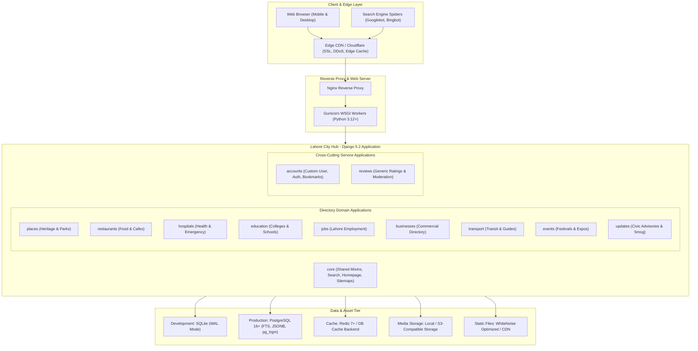
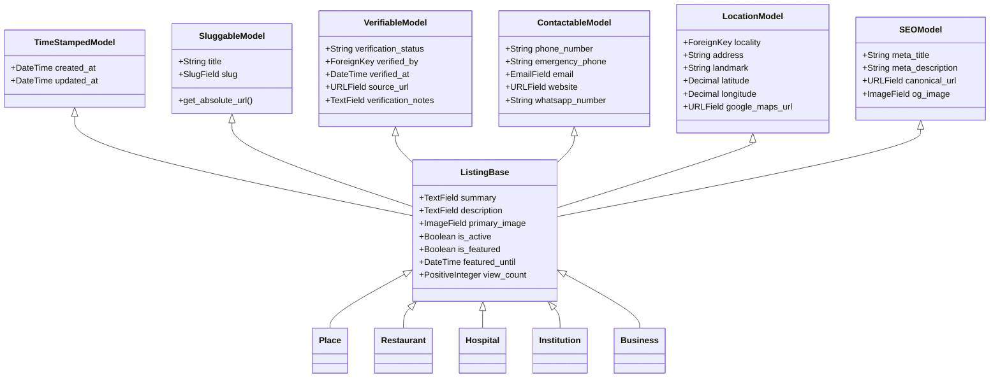
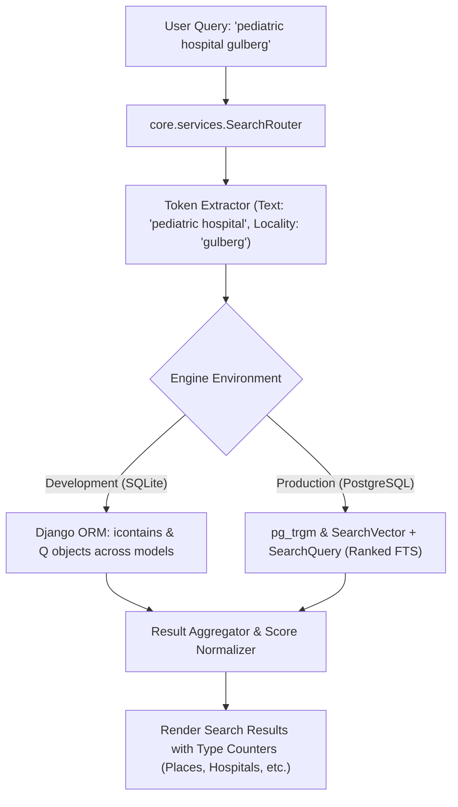

# System Architecture Document (SAD)
> **Project:** Lahore City Hub (LCH)  
> **Pattern:** Domain-Driven Modular Monolith  
> **Framework:** Django 5.2 LTS / Python 3.12+  
> **Document Version:** 1.0.0  
> **Architectural Status:** Approved for Implementation

---

## 1. Architectural Philosophy & Principles

The architectural design of **Lahore City Hub** adheres to the following foundational tenets:

1. **Modular Monolith over Microservices:**  
   Given the cohesive nature of a regional city portal, a distributed microservices architecture introduces unnecessary operational friction, network latency, distributed transaction complexity, and deployment overhead. A cleanly architected Django **Modular Monolith** provides strict domain boundaries, fast internal method calls, single-transaction database operations, unified authentication, and effortless local development while remaining horizontally scalable.

2. **Server-Side Rendering (SSR) with Progressive Enhancement:**  
   Search Engine Optimization (SEO) and low-latency mobile rendering on mobile networks are critical success factors. Standard server-rendered Django templates guarantee that every web spider (Googlebot, Bingbot) and mobile device receives fully baked HTML instantly. Interactive widgets (e.g., locality dropdowns, bookmark toggles, image lightboxes, search filters) are progressively enhanced with lightweight Vanilla JavaScript and Bootstrap 5.

3. **High Cohesion, Low Coupling via Abstract Mixins:**  
   Common behavioral patterns across Lahore's directory domains (historical sites, cafes, hospitals, businesses) share recurring attributes: geographical coordinates, contact telephone numbers, operating schedules, SEO metadata, and verification audit trails. Rather than creating a single massive polymorphic table or duplicating code, we leverage **reusable abstract model mixins** in the `core` application that concrete domain apps inherit.

4. **Stateless Web Application Tier:**  
   The application servers do not maintain local in-memory session state or write uploaded media files to ephemeral application containers. Sessions and caches reside in configured backends (PostgreSQL/Redis), and user uploads are managed via decoupled storage adapters. This allows trivial horizontal auto-scaling behind a load balancer (Nginx / Cloudflare).

---

## 2. High-Level System Architecture Diagram



---

## 3. Application Domain Breakdown

The application space is structured into 12 distinct Django apps, each with a strict single responsibility:

| Application | Domain Responsibility | Key Business Entities |
| :--- | :--- | :--- |
| **`core`** | Platform framework, base abstract models, homepage view, global search router, shared templates, SEO sitemaps, error handlers, emergency helpline widget. | `SiteConfiguration`, `EmergencyHelpline`, `LocalityZone` |
| **`places`** | Historical sites, Mughal architecture, city gardens, public museums, religious landmarks, ticketing, photography guidelines. | `Place`, `PlaceCategory`, `PlaceGalleryImage` |
| **`restaurants`** | Dining establishments, food street vendors, cafes, catering services, culinary cuisines, Ramadan timings, seating amenities. | `Restaurant`, `Cuisine`, `RestaurantFeature`, `MenuHighlight` |
| **`hospitals`** | Healthcare institutions, 24/7 trauma centers, specialized clinics, emergency hotlines, ambulance stations, blood banks. | `Hospital`, `MedicalSpecialty`, `EmergencyService` |
| **`education`** | Universities, colleges, intermediate academies, K-12 schools, vocational centers, accreditation boards, admission cycles. | `Institution`, `EducationType`, `AccreditationBoard` |
| **`jobs`** | Localized job listings across Lahore, employer profiles, application links, sector filters, salary ranges. | `JobListing`, `Employer`, `JobCategory` |
| **`businesses`** | B2B/B2C commercial directory, retail outlets, professional services, business claiming workflow. | `Business`, `BusinessCategory`, `BusinessClaim` |
| **`transport`** | Transit guides (Orange Line Metro, Metrobus, Speedo feeder buses), intercity bus terminals, railway stations, airport logistics. | `TransitMode`, `TransitRoute`, `TransitStation`, `FareGuide` |
| **`events`** | Cultural festivals, art biennales, literary conferences, trade expos, venue directories, event calendars. | `Event`, `EventCategory`, `EventVenue` |
| **`updates`** | Civic advisories, smog reports, traffic police diversions, weather warnings, municipal announcements with official source citations. | `CityUpdate`, `UpdateCategory`, `SourceAgency` |
| **`accounts`** | Custom user model (email-based auth), user profile dashboards, bookmark collections, claim tracking. | `CustomUser`, `UserProfile`, `UserBookmark` |
| **`reviews`** | Reusable generic rating and review engine with anti-spam moderation workflows, attached via Generic Foreign Keys. | `Review`, `ReviewVote` |

---

## 4. Shared Model Hierarchy (The Core Engine)

To guarantee consistent data architecture without code duplication, every directory entity inherits from an extensible chain of abstract base classes located in `core.models`:



### Rationale for Concrete Inheritance over One Giant Table:
1. **Domain-Specific Queries:** Hospitals need fields like `is_emergency_trauma_center` and `has_blood_bank`, while Restaurants need `cuisine_types` and `price_tier`. Packing all 150 fields into a single monolithic table creates massive sparse rows and indexing penalties.
2. **Database Normalization:** Independent domain tables ensure referential integrity, domain-specific foreign keys, and clean migrations.
3. **Common Interface:** Because all listings inherit `ListingBase`, search views and template cards can render common data attributes (`title`, `slug`, `primary_image`, `locality`, `verification_status`, `is_featured`) with uniform template partials (`templates/shared/cards/_listing_card.html`).

---

## 5. URL Namespacing Strategy

Each app implements its own URL configuration registered with an explicit `app_name` namespace. This eliminates reverse URL routing collisions:

```python
# config/urls.py routing layout
urlpatterns = [
    path('admin/', admin.site.urls),
    path('', include(('core.urls', 'core'), namespace='core')),
    path('places/', include(('places.urls', 'places'), namespace='places')),
    path('restaurants/', include(('restaurants.urls', 'restaurants'), namespace='restaurants')),
    path('hospitals/', include(('hospitals.urls', 'hospitals'), namespace='hospitals')),
    path('education/', include(('education.urls', 'education'), namespace='education')),
    path('jobs/', include(('jobs.urls', 'jobs'), namespace='jobs')),
    path('businesses/', include(('businesses.urls', 'businesses'), namespace='businesses')),
    path('transport/', include(('transport.urls', 'transport'), namespace='transport')),
    path('events/', include(('events.urls', 'events'), namespace='events')),
    path('updates/', include(('updates.urls', 'updates'), namespace='updates')),
    path('accounts/', include(('accounts.urls', 'accounts'), namespace='accounts')),
    path('reviews/', include(('reviews.urls', 'reviews'), namespace='reviews')),
]
```

### URL Slug Conventions:
- **Listings index:** `/<app>/` (e.g., `/places/`, `/restaurants/`, `/hospitals/`)
- **Category filtered:** `/<app>/category/<category-slug>/` (e.g., `/places/category/mughal-heritage/`)
- **Locality filtered:** `/<app>/locality/<locality-slug>/` (e.g., `/restaurants/locality/gulberg/`)
- **Detail item:** `/<app>/<item-slug>/` (e.g., `/places/badshahi-mosque/`, `/hospitals/shaukat-khanum/`)

---

## 6. Template & UI Component Hierarchy

The template system utilizes component-driven inheritance to enforce brand consistency and DRY HTML:

```
templates/
├── base.html                     # Root HTML5 wrapper, meta, CSS/JS includes
├── navbar.html                   # Global header with mega-search & auth state
├── footer.html                   # Multi-column civic footer & quick links
├── components/
│   ├── _breadcrumbs.html         # Schema-compliant breadcrumb trail
│   ├── _verification_badge.html  # Standardized verified/official badge
│   ├── _emergency_ribbon.html    # Emergency helpline top bar
│   ├── _pagination.html          # Accessible pagination controls
│   └── _rating_stars.html        # 5-star rating visualizer
├── layouts/
│   ├── directory_list.html       # Dual-pane layout: sidebar filters + grid
│   └── directory_detail.html     # Detail layout: hero, facts, content, map, reviews
└── <app_name>/                   # App-specific overrides
    ├── list.html
    └── detail.html
```

---

## 7. Search Architecture

The search functionality is designed with a two-phase abstraction layer:



---

## 8. Caching & Performance Architecture

To maintain lightning-fast response times:
1. **Template Fragment Caching:** The emergency helpline ribbon, category cards, and navigation menus are cached for 24 hours (``).
2. **Queryset Caching:** Static taxonomies (Localities, Categories, Transit routes) are cached using Django's low-level cache API.
3. **Invalidation via Signals:** Domain models invoke cache invalidation upon `.save()` or `.delete()` using targeted cache keys.
4. **Static File Pipeline:** WhiteNoise handles Gzip / Brotli compression and cache busting via manifest storage (`CompressedManifestStaticFilesStorage`).
