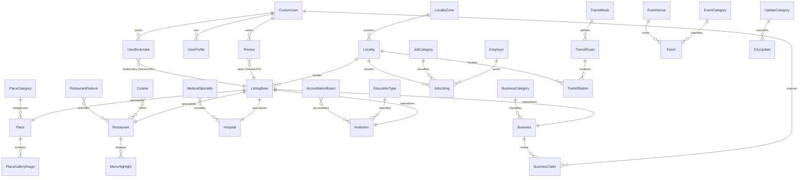

# Database Architecture & Schema Design (ERD)
> **Project:** Lahore City Hub (LCH)  
> **Databases:** SQLite (Development) / PostgreSQL 16+ (Production)  
> **ORM:** Django 5.2 ORM with strict referential constraints  
> **Document Version:** 1.0.0  
> **Architectural Status:** Approved

---

## 1. Conceptual Entity Relationship Overview

The diagram below maps core directory relationships, spatial locality hierarchies, user accounts, and generic relationships (reviews and bookmarks):

---

## 2. Reusable Abstract Base Models (`core.models`)

### 2.1 `TimeStampedModel`
| Field Name | Type | Options / Constraints | Rationale |
| :--- | :--- | :--- | :--- |
| `created_at` | `DateTimeField` | `auto_now_add=True`, `db_index=True` | Records creation timestamp for audit and chronological queries. |
| `updated_at` | `DateTimeField` | `auto_now=True` | Records last modification timestamp for caching and freshness tracking. |

### 2.2 `SluggableModel`
| Field Name | Type | Options / Constraints | Rationale |
| :--- | :--- | :--- | :--- |
| `title` | `CharField(max_length=255)` | `db_index=True` | Primary display name in English. |
| `title_ur` | `CharField(max_length=255)` | `blank=True, null=True` | Optional Urdu title representation for localized display. |
| `slug` | `SlugField(max_length=280)` | `unique=True, db_index=True` | SEO-friendly human-readable identifier. Auto-generated from title. |

### 2.3 `VerifiableModel`
| Field Name | Type | Options / Constraints | Rationale |
| :--- | :--- | :--- | :--- |
| `verification_status` | `CharField(max_length=20)` | `choices=VerificationStatus.choices`, `default='unverified'`, `db_index=True` | Status options: `unverified`, `pending`, `verified`, `official_claimed`. |
| `verified_by` | `ForeignKey(CustomUser)` | `null=True, blank=True, on_delete=SET_NULL`, `related_name='+'` | Tracks staff member or auditor who performed verification. |
| `last_verified_at` | `DateTimeField` | `null=True, blank=True, db_index=True` | The public date shown to users ("Verified on: Oct 2026"). |
| `source_url` | `URLField(max_length=500)` | `blank=True` | Primary source URL (official site, gazette, or municipal registry). |
| `verification_notes`| `TextField` | `blank=True` | Internal editorial notes explaining verification proof. |

### 2.4 `ContactableModel`
| Field Name | Type | Options / Constraints | Rationale |
| :--- | :--- | :--- | :--- |
| `phone_number` | `CharField(max_length=30)` | `blank=True` | Standard formatted telephone/mobile number. |
| `emergency_phone` | `CharField(max_length=30)` | `blank=True` | Dedicated 24/7 or priority line (crucial for hospitals/police). |
| `email` | `EmailField` | `blank=True` | Official contact email address. |
| `website` | `URLField(max_length=500)` | `blank=True` | Official website or domain. |
| `whatsapp_number` | `CharField(max_length=30)` | `blank=True` | Normalized Pakistani international format (`+923001234567`). |

### 2.5 `LocationModel`
| Field Name | Type | Options / Constraints | Rationale |
| :--- | :--- | :--- | :--- |
| `locality` | `ForeignKey(Locality)` | `on_delete=PROTECT, related_name='%(class)s_listings'` | Relational link to Lahore zone/locality taxonomy. |
| `address` | `CharField(max_length=500)` | `blank=False` | Complete street address. |
| `landmark` | `CharField(max_length=255)` | `blank=True` | Local reference point (e.g., "Near Liberty Roundabout"). |
| `latitude` | `DecimalField(max_digits=9, decimal_places=6)` | `null=True, blank=True` | Geographic latitude coordinate for map pin rendering. |
| `longitude` | `DecimalField(max_digits=9, decimal_places=6)` | `null=True, blank=True` | Geographic longitude coordinate for map pin rendering. |
| `google_maps_url` | `URLField(max_length=500)` | `blank=True` | Direct link to Google Maps navigation route. |

### 2.6 `SEOModel`
| Field Name | Type | Options / Constraints | Rationale |
| :--- | :--- | :--- | :--- |
| `meta_title` | `CharField(max_length=70)` | `blank=True` | Page title override (falls back to title if blank). |
| `meta_description` | `CharField(max_length=160)` | `blank=True` | Search engine snippet description. |
| `canonical_url` | `URLField(max_length=500)` | `blank=True` | Canonical link tag override if syndicated. |
| `og_image` | `ImageField(upload_to='seo/')` | `blank=True, null=True` | Social share preview image (1200x630 target). |

### 2.7 `ListingBase` (Abstract Concrete Directory Foundation)
*Inherits: `TimeStampedModel`, `SluggableModel`, `VerifiableModel`, `ContactableModel`, `LocationModel`, `SEOModel`*
| Field Name | Type | Options / Constraints | Rationale |
| :--- | :--- | :--- | :--- |
| `summary` | `CharField(max_length=350)` | `blank=False` | Short concise description for directory cards and mobile previews. |
| `description` | `TextField` | `blank=False` | Full detailed editorial description. |
| `primary_image` | `ImageField(upload_to='%(class)s/banners/')` | `blank=True, null=True` | Primary banner image. |
| `is_active` | `BooleanField` | `default=True, db_index=True` | Soft-delete / publishing switch. |
| `is_featured` | `BooleanField` | `default=False, db_index=True` | Priority visibility flag. |
| `featured_until`| `DateTimeField` | `null=True, blank=True` | Automatic expiration date for featured placement. |
| `view_count` | `PositiveIntegerField` | `default=0` | Analytic view counter. |

---

## 3. Detailed Data Models by Application

### 3.1 `core` Models
- **`LocalityZone`**: Represents major administrative or cultural sectors (e.g., "Cantonment & DHA", "Gulberg & Central", "Walled City & Northern", "Johar Town & Western", "Model Town & Southern").
  - `name`: `CharField(max_length=100, unique=True)`
  - `slug`: `SlugField(unique=True)`
  - `description`: `TextField(blank=True)`
- **`Locality`**: Specific neighborhoods within zones.
  - `zone`: `ForeignKey(LocalityZone, on_delete=CASCADE, related_name='localities')`
  - `name`: `CharField(max_length=120, db_index=True)` (e.g., "Gulberg III", "DHA Phase 5", "Johar Town Phase 2", "Anarkali")
  - `slug`: `SlugField(unique=True)`
  - `postal_code`: `CharField(max_length=10, blank=True)`
- **`EmergencyHelpline`**: Fast-access civic contact cards.
  - `name`: `CharField(max_length=100)` (e.g., "Rescue 1122", "Lahore Traffic Police")
  - `short_code`: `CharField(max_length=15)` (e.g., "1122", "1915")
  - `full_phone_number`: `CharField(max_length=30, blank=True)`
  - `agency_name`: `CharField(max_length=150)`
  - `is_active`: `BooleanField(default=True)`
  - `display_order`: `PositiveSmallIntegerField(default=0)`

### 3.2 `accounts` Models
- **`CustomUser`**: Subclasses `AbstractUser`.
  - `email`: `EmailField(unique=True, db_index=True)` (Acts as `USERNAME_FIELD`)
  - `phone_number`: `CharField(max_length=25, blank=True)`
  - `is_verified`: `BooleanField(default=False)`
  - `role`: `CharField(max_length=20, choices=['member', 'business_owner', 'moderator', 'admin'], default='member')`
  - `avatar`: `ImageField(upload_to='avatars/', blank=True, null=True)`
- **`UserProfile`**: OneToOne relation to `CustomUser`.
  - `user`: `OneToOneField(CustomUser, on_delete=CASCADE, related_name='profile')`
  - `bio`: `TextField(max_length=500, blank=True)`
  - `home_locality`: `ForeignKey(Locality, null=True, blank=True, on_delete=SET_NULL)`
  - `receive_smog_alerts`: `BooleanField(default=True)`
  - `receive_event_digests`: `BooleanField(default=False)`
- **`UserBookmark`**: Generic bookmarking engine.
  - `user`: `ForeignKey(CustomUser, on_delete=CASCADE, related_name='bookmarks')`
  - `content_type`: `ForeignKey(ContentType, on_delete=CASCADE)`
  - `object_id`: `PositiveIntegerField()`
  - `content_object`: `GenericForeignKey('content_type', 'object_id')`
  - `notes`: `CharField(max_length=200, blank=True)`
  - `created_at`: `DateTimeField(auto_now_add=True)`
  - *UniqueConstraint:* `['user', 'content_type', 'object_id']`

### 3.3 `places` Models
- **`PlaceCategory`**: `name`, `slug`, `icon_class`, `description`
- **`Place`** *(inherits `ListingBase`)*:
  - `category`: `ForeignKey(PlaceCategory, on_delete=PROTECT, related_name='places')`
  - `architectural_era`: `CharField(max_length=100, blank=True)` (e.g., "Mughal (1673 AD)", "British Colonial", "Post-Independence")
  - `entry_fee_pkr`: `DecimalField(max_digits=8, decimal_places=2, default=0.00)`
  - `entry_fee_foreigner_pkr`: `DecimalField(max_digits=8, decimal_places=2, default=0.00)`
  - `opening_time`: `TimeField(null=True, blank=True)`
  - `closing_time`: `TimeField(null=True, blank=True)`
  - `closed_on_days`: `CharField(max_length=50, blank=True)` (e.g., "Mondays")
  - `photography_policy`: `CharField(max_length=150, blank=True)` (e.g., "Free mobile photography; commercial cameras require WCLA permit")
  - `wheelchair_accessible`: `BooleanField(default=False)`
  - `nearest_metro_station`: `ForeignKey('transport.TransitStation', null=True, blank=True, on_delete=SET_NULL)`
- **`PlaceGalleryImage`**:
  - `place`: `ForeignKey(Place, on_delete=CASCADE, related_name='gallery_images')`
  - `image`: `ImageField(upload_to='places/gallery/')`
  - `caption`: `CharField(max_length=255, blank=True)`
  - `photographer_credit`: `CharField(max_length=150, blank=True)`
  - `display_order`: `PositiveSmallIntegerField(default=0)`

### 3.4 `restaurants` Models
- **`Cuisine`**: `name`, `slug`, `description`
- **`RestaurantFeature`**: `name`, `slug`, `icon_class` (e.g., "Family Seating", "Rooftop Dining", "Outdoor Seating", "Halal Certified", "Wi-Fi", "Valet Parking")
- **`Restaurant`** *(inherits `ListingBase`)*:
  - `price_tier`: `CharField(max_length=5, choices=[('$', 'Budget / Street'), ('$$', 'Casual'), ('$$$', 'Upscale'), ('$$$$', 'Fine Dining')], default='$$')`
  - `cuisines`: `ManyToManyField(Cuisine, related_name='restaurants')`
  - `features`: `ManyToManyField(RestaurantFeature, related_name='restaurants')`
  - `seating_capacity`: `PositiveIntegerField(null=True, blank=True)`
  - `has_family_hall`: `BooleanField(default=True)`
  - `provides_takeaway`: `BooleanField(default=True)`
  - `provides_delivery`: `BooleanField(default=False)`
  - `ramadan_timings`: `CharField(max_length=255, blank=True)` (e.g., "Sehri buffet: 02:00 AM - Fajr; Iftar dinner: Maghrib - 09:00 PM")
- **`MenuHighlight`**:
  - `restaurant`: `ForeignKey(Restaurant, on_delete=CASCADE, related_name='menu_highlights')`
  - `item_name`: `CharField(max_length=150)`
  - `description`: `CharField(max_length=255, blank=True)`
  - `price_pkr`: `DecimalField(max_digits=8, decimal_places=2, null=True, blank=True)`
  - `is_signature`: `BooleanField(default=False)`

### 3.5 `hospitals` Models
- **`MedicalSpecialty`**: `name`, `slug`, `description` (e.g., "Cardiology", "Trauma & Orthopedics", "Pediatrics", "Oncology", "Neurology", "Obstetrics & Gynecology")
- **`Hospital`** *(inherits `ListingBase`)*:
  - `hospital_type`: `CharField(max_length=20, choices=[('public', 'Public Government Hospital'), ('private', 'Private Hospital'), ('trust', 'Charitable / Trust Hospital')], default='private')`
  - `specialties`: `ManyToManyField(MedicalSpecialty, related_name='hospitals')`
  - `is_24_7_emergency`: `BooleanField(default=True, db_index=True)`
  - `has_trauma_center`: `BooleanField(default=False)`
  - `has_blood_bank`: `BooleanField(default=False)`
  - `has_24_7_pharmacy`: `BooleanField(default=True)`
  - `bed_capacity`: `PositiveIntegerField(null=True, blank=True)`
  - `ambulance_direct_phone`: `CharField(max_length=30, blank=True)`

### 3.6 `education` Models
- **`EducationType`**: `name`, `slug` (`University`, `Degree College`, `Higher Secondary School`, `Vocational Institute`, `Research Center`)
- **`AccreditationBoard`**: `name`, `abbreviation`, `website` (e.g., "Higher Education Commission", "HEC", "Pakistan Engineering Council", "PEC", "BISE Lahore", "Cambridge Assessment")
- **`Institution`** *(inherits `ListingBase`)*:
  - `education_type`: `ForeignKey(EducationType, on_delete=PROTECT, related_name='institutions')`
  - `accreditations`: `ManyToManyField(AccreditationBoard, related_name='institutions', blank=True)`
  - `gender_policy`: `CharField(max_length=20, choices=[('coed', 'Co-Education'), ('girls', 'Female Only'), ('boys', 'Male Only')], default='coed')`
  - `established_year`: `PositiveIntegerField(null=True, blank=True)`
  - `admission_cycles`: `CharField(max_length=200, blank=True)` (e.g., "Fall Cycle: August–September; Spring: December–January")
  - `prospectus_url`: `URLField(max_length=500, blank=True)`

### 3.7 `jobs` Models
- **`JobCategory`**: `name`, `slug`, `icon_class` (e.g., "Software & IT", "Healthcare & Medical", "Education & Lecturing", "Sales & Marketing", "Accounting & Finance")
- **`Employer`**:
  - `name`: `CharField(max_length=200)`
  - `slug`: `SlugField(unique=True)`
  - `logo`: `ImageField(upload_to='employers/logos/', blank=True, null=True)`
  - `website`: `URLField(blank=True)`
  - `locality`: `ForeignKey(Locality, on_delete=PROTECT, related_name='employers')`
  - `address`: `CharField(max_length=300)`
  - `is_verified`: `BooleanField(default=False)`
- **`JobListing`** *(inherits `TimeStampedModel`, `SEOModel`)*:
  - `title`: `CharField(max_length=200, db_index=True)`
  - `slug`: `SlugField(max_length=250, unique=True)`
  - `employer`: `ForeignKey(Employer, on_delete=CASCADE, related_name='jobs')`
  - `category`: `ForeignKey(JobCategory, on_delete=PROTECT, related_name='jobs')`
  - `locality`: `ForeignKey(Locality, on_delete=PROTECT, related_name='jobs')`
  - `employment_type`: `CharField(max_length=20, choices=[('full_time', 'Full-time'), ('part_time', 'Part-time'), ('contract', 'Contract'), ('internship', 'Internship')])`
  - `experience_level`: `CharField(max_length=20, choices=[('entry', 'Entry Level'), ('mid', 'Mid Level (2-4 yrs)'), ('senior', 'Senior Level (5+ yrs)'), ('lead', 'Executive / Lead')])`
  - `salary_min_pkr`: `DecimalField(max_digits=10, decimal_places=2, null=True, blank=True)`
  - `salary_max_pkr`: `DecimalField(max_digits=10, decimal_places=2, null=True, blank=True)`
  - `is_salary_negotiable`: `BooleanField(default=True)`
  - `description`: `TextField()`
  - `requirements`: `TextField()`
  - `application_url`: `URLField(max_length=500, blank=True)`
  - `application_email`: `EmailField(blank=True)`
  - `deadline`: `DateField(db_index=True)`
  - `is_active`: `BooleanField(default=True, db_index=True)`
  - `verification_status`: `CharField(max_length=20, choices=[('pending', 'Pending Verification'), ('verified', 'Verified Legitimate'), ('flagged', 'Flagged / Suspicious')], default='pending')`

### 3.8 `businesses` Models
- **`BusinessCategory`**: `name`, `slug`, `icon_class`
- **`Business`** *(inherits `ListingBase`)*:
  - `category`: `ForeignKey(BusinessCategory, on_delete=PROTECT, related_name='businesses')`
  - `registration_number`: `CharField(max_length=100, blank=True)` (SECP or Chamber of Commerce registration if provided)
  - `operating_hours`: `CharField(max_length=200, blank=True)` (e.g., "Monday–Saturday: 10:00 AM – 09:00 PM; Sunday Closed")
- **`BusinessClaim`**:
  - `business`: `ForeignKey(Business, on_delete=CASCADE, related_name='claims')`
  - `claimant`: `ForeignKey(CustomUser, on_delete=CASCADE, related_name='business_claims')`
  - `claimant_role`: `CharField(max_length=100)` (e.g., "Owner", "Managing Director", "Authorized Marketing Manager")
  - `official_email`: `EmailField()`
  - `contact_phone`: `CharField(max_length=30)`
  - `proof_document`: `FileField(upload_to='claims/proofs/')` (e.g., utility bill, SECP certificate, business card)
  - `status`: `CharField(max_length=20, choices=[('pending', 'Pending Review'), ('under_review', 'Under Investigation'), ('approved', 'Approved'), ('rejected', 'Rejected')], default='pending')`
  - `admin_notes`: `TextField(blank=True)`
  - `reviewed_by`: `ForeignKey(CustomUser, null=True, blank=True, on_delete=SET_NULL, related_name='+')`
  - `reviewed_at`: `DateTimeField(null=True, blank=True)`
  - `created_at`: `DateTimeField(auto_now_add=True)`

### 3.9 `transport` Models
- **`TransitMode`**: `name`, `slug`, `icon_class` (e.g., "Orange Line Metro Train", "Metrobus Line", "Speedo Feeder Bus", "Intercity Bus Terminal", "Railway Station")
- **`TransitRoute`**:
  - `mode`: `ForeignKey(TransitMode, on_delete=CASCADE, related_name='routes')`
  - `route_name`: `CharField(max_length=150)` (e.g., "Orange Line: Ali Town to Dera Gujran")
  - `route_code`: `CharField(max_length=30)` (e.g., "OLMT-01", "MB-01")
  - `origin_station`: `CharField(max_length=100)`
  - `destination_station`: `CharField(max_length=100)`
  - `total_stations`: `PositiveSmallIntegerField()`
  - `total_distance_km`: `DecimalField(max_digits=5, decimal_places=2)`
  - `operating_schedule`: `CharField(max_length=150)` (e.g., "06:00 AM - 10:00 PM daily")
  - `fare_info`: `TextField()`
- **`TransitStation`**:
  - `route`: `ForeignKey(TransitRoute, on_delete=CASCADE, related_name='stations')`
  - `station_name`: `CharField(max_length=120)`
  - `station_number`: `PositiveSmallIntegerField()`
  - `locality`: `ForeignKey(Locality, on_delete=PROTECT, related_name='transit_stations')`
  - `is_interchange`: `BooleanField(default=False)`
  - `latitude`: `DecimalField(max_digits=9, decimal_places=6, null=True, blank=True)`
  - `longitude`: `DecimalField(max_digits=9, decimal_places=6, null=True, blank=True)`

### 3.10 `events` Models
- **`EventCategory`**: `name`, `slug` (e.g., "Cultural & Literary", "Art & Exhibitions", "Tech & Business", "Sports", "Music & Performing Arts")
- **`EventVenue`**: `name`, `slug`, `address`, `locality` (ForeignKey `Locality`), `capacity` (`PositiveIntegerField(null=True)`), `google_maps_url`
- **`Event`** *(inherits `TimeStampedModel`, `SEOModel`, `VerifiableModel`)*:
  - `title`: `CharField(max_length=220)`
  - `slug`: `SlugField(max_length=250, unique=True)`
  - `category`: `ForeignKey(EventCategory, on_delete=PROTECT, related_name='events')`
  - `venue`: `ForeignKey(EventVenue, on_delete=PROTECT, related_name='events')`
  - `start_datetime`: `DateTimeField(db_index=True)`
  - `end_datetime`: `DateTimeField(db_index=True)`
  - `ticket_policy`: `CharField(max_length=20, choices=[('free', 'Free Entry'), ('ticketed', 'Paid Ticket Required'), ('registration', 'Free with Prior Registration'), ('invite_only', 'By Invitation Only')])`
  - `ticket_price_pkr`: `DecimalField(max_digits=8, decimal_places=2, null=True, blank=True)`
  - `ticket_or_registration_url`: `URLField(max_length=500, blank=True)`
  - `organizer_name`: `CharField(max_length=150)`
  - `organizer_contact`: `CharField(max_length=100, blank=True)`
  - `banner_image`: `ImageField(upload_to='events/banners/', blank=True, null=True)`
  - `description`: `TextField()`
  - `is_featured`: `BooleanField(default=False)`

### 3.11 `updates` Models
- **`UpdateCategory`**: `name`, `slug` (e.g., "Smog & Air Quality", "Traffic Diversions", "Weather Alerts", "Civic Services (WASA/LESCO)", "Public Holidays")
- **`CityUpdate`** *(inherits `TimeStampedModel`, `SEOModel`)*:
  - `title`: `CharField(max_length=220)`
  - `slug`: `SlugField(max_length=250, unique=True)`
  - `category`: `ForeignKey(UpdateCategory, on_delete=PROTECT, related_name='updates')`
  - `severity`: `CharField(max_length=20, choices=[('info', 'General Advisory'), ('notice', 'Civic Notice'), ('caution', 'Traffic / Weather Alert'), ('emergency', 'Urgent / Red Alert')], default='info')`
  - `summary`: `CharField(max_length=350)`
  - `content`: `TextField()`
  - `issuing_authority`: `CharField(max_length=150)` (e.g., "City Traffic Police Lahore", "Punjab Environment Protection Agency", "District Administration Lahore")
  - `official_source_url`: `URLField(max_length=500)`
  - `valid_from`: `DateTimeField(default=timezone.now)`
  - `valid_until`: `DateTimeField(null=True, blank=True)`
  - `is_pinned`: `BooleanField(default=False)`
  - `is_active`: `BooleanField(default=True, db_index=True)`

### 3.12 `reviews` Models
- **`Review`** *(inherits `TimeStampedModel`)*:
  - `user`: `ForeignKey(CustomUser, on_delete=CASCADE, related_name='reviews')`
  - `content_type`: `ForeignKey(ContentType, on_delete=CASCADE)`
  - `object_id`: `PositiveIntegerField()`
  - `content_object`: `GenericForeignKey('content_type', 'object_id')`
  - `rating`: `PositiveSmallIntegerField(choices=[(1, '1 Star'), (2, '2 Stars'), (3, '3 Stars'), (4, '4 Stars'), (5, '5 Stars')])`
  - `title`: `CharField(max_length=120, blank=True)`
  - `comment`: `TextField()`
  - `moderation_status`: `CharField(max_length=20, choices=[('pending', 'Pending Approval'), ('approved', 'Approved & Published'), ('rejected', 'Rejected as Spam / Inappropriate')], default='pending', db_index=True)`
  - `moderated_by`: `ForeignKey(CustomUser, null=True, blank=True, on_delete=SET_NULL, related_name='+')`
  - `moderated_at`: `DateTimeField(null=True, blank=True)`
  - *Indexes:* Compound index on `['content_type', 'object_id', 'moderation_status']`

---

## 4. Database Indexing & Performance Strategy

1. **B-Tree Indexes on Slugs and Lookups:** All model `slug` and `is_active` fields carry explicit `db_index=True`.
2. **Compound Indexes:**
   - On `ListingBase` child models: `Index(fields=['is_active', 'locality', '-created_at'])`
   - On `JobListing`: `Index(fields=['is_active', 'deadline', 'locality'])`
   - On `Event`: `Index(fields=['is_featured', 'start_datetime'])`
3. **Foreign Key Protection:** All relations to spatial entities (`Locality`) use `on_delete=models.PROTECT` to prevent accidental cascading deletion of city geography.
4. **PostgreSQL Trigram Search Index:** In production, GiST/GIN indexes with `gin_trgm_ops` will be applied on `title` and `description` fields for instantaneous fuzzy matching.
