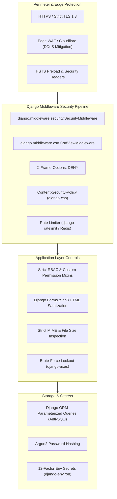

# Security Architecture & OWASP Hardening Plan
> **Project:** Lahore City Hub (LCH)  
> **Framework:** Django 5.2 LTS Security Features & Hardened Middleware  
> **Standard:** OWASP Top 10 (2021/2026 Standards) & CIS Web Application Benchmarks  
> **Document Version:** 1.0.0  
> **Status:** Final Architectural Specification

---

## 1. Threat Modeling & Core Defense-in-Depth Principles

As a public digital portal handling civic information, user authentication, review submissions, and business ownership claims, **Lahore City Hub** enforces defense-in-depth across the web tier, application tier, data tier, and operational processes.



---

## 2. OWASP Top 10 Mitigation Matrix

### 2.1 A01: Broken Access Control
- **Insecure Direct Object References (IDOR):** Business owners editing their listings or members modifying reviews are validated strictly via ownership checks:
  ```python
  # Example row-level ownership guard
  class ClaimedBusinessRequiredMixin(UserPassesTestMixin):
      def test_func(self):
          business = self.get_object()
          return business.claimed_by == self.request.user or self.request.user.is_staff
  ```
- **Administrative Quarantine:** The Django Admin URL is configurable via environment variable (`DJANGO_ADMIN_URL=super-secure-portal-adm-89x/`), obfuscating default `/admin/` discovery.
- **Strict Method Protection:** All state-mutating actions (bookmarking, submitting claims, writing reviews) require HTTP POST; GET requests are strictly idempotent.

### 2.2 A02: Cryptographic Failures
- **Password Hashing:** Enabled default to `Argon2PasswordHasher` with fallback to `PBKDF2PasswordHasher`:
  ```python
  PASSWORD_HASHERS = [
      'django.contrib.auth.hashers.Argon2PasswordHasher',
      'django.contrib.auth.hashers.PBKDF2PasswordHasher',
  ]
  ```
- **Transport Security (Production):**
  - `SECURE_SSL_REDIRECT = True`
  - `SESSION_COOKIE_SECURE = True`
  - `CSRF_COOKIE_SECURE = True`
  - `SECURE_HSTS_SECONDS = 31536000` (1 Year)
  - `SECURE_HSTS_INCLUDE_SUBDOMAINS = True`
  - `SECURE_HSTS_PRELOAD = True`

### 2.3 A03: Injection (SQL, XSS, Command)
- **SQL Injection:** 100% of database interactions leverage Django ORM's parameterized query builder. Raw SQL (`cursor.execute()`) is strictly prohibited across the codebase.
- **Cross-Site Scripting (XSS):**
  - Django template auto-escaping is active across all views.
  - Where editorial descriptions allow rich formatting, raw input is sanitized using Rust-backed `nh3` (or `bleach`) with an ultra-strict whitelist (`<p>`, `<b>`, `<i>`, `<ul>`, `<li>`, `<a>`). Script tags, iframes, inline event handlers (`onload`, `onerror`) are stripped.
- **Contextual URL Validation:** All external links (`source_url`, `website`, `google_maps_url`) are validated using `URLValidator(schemes=['http', 'https'])` to reject `javascript:` pseudo-protocol attacks.

### 2.4 A04: Insecure Design & Business Logic Abuse
- **Claim Squatting Prevention:** Multiple pending claims on the same business lock subsequent claim attempts until the moderation queue resolves the existing claim.
- **Review Astroturfing Mitigation:** Database unique constraint `UniqueConstraint(fields=['user', 'content_type', 'object_id'])` strictly prohibits a single user account from flooding multiple reviews onto a single establishment.

### 2.5 A05: Security Misconfiguration
- **Environment Isolation:** Zero hardcoded secrets. All credentials (database passwords, secret key, email credentials) are read via environment variables (`django-environ`).
- **Production Guardrails:**
  - `DEBUG = False` enforced in production. A custom check in `config/settings/production.py` immediately raises `ImproperlyConfigured` if `DEBUG` evaluates to `True`.
- **Security Headers Configuration:**
  ```python
  SECURE_CONTENT_TYPE_NOSNIFF = True
  X_FRAME_OPTIONS = 'DENY'
  SECURE_BROWSER_XSS_FILTER = True
  SECURE_REFERRER_POLICY = 'strict-origin-when-cross-origin'
  
  # Content Security Policy (via django-csp)
  CSP_DEFAULT_SRC = ("'self'",)
  CSP_STYLE_SRC = ("'self'", "https://cdn.jsdelivr.net", "'unsafe-inline'")
  CSP_SCRIPT_SRC = ("'self'", "https://cdn.jsdelivr.net")
  CSP_IMG_SRC = ("'self'", "data:", "https://*.tile.openstreetmap.org")
  CSP_FONT_SRC = ("'self'", "https://cdn.jsdelivr.net")
  ```

### 2.6 A06: Vulnerable and Outdated Dependencies
- Dependency tree pinned explicitly in `requirements/base.txt` and `requirements/production.txt`.
- Automated security scanning via `pip-audit` integrated into GitHub Actions CI pipeline on every Pull Request.

### 2.7 A07: Identification & Authentication Failures
- **Brute-Force Protection:** Integration of `django-axes` to monitor failed authentication attempts. A client IP exceeding 5 failed login attempts within 10 minutes is locked out for 1 hour.
- **Password Strength Enforcement:**
  - `MinimumLengthValidator(min_length=10)`
  - `CommonPasswordValidator`
  - `NumericPasswordValidator`
  - `UserAttributeSimilarityValidator`
- **Session Protection:**
  - `SESSION_COOKIE_HTTPONLY = True` (Blocks JavaScript `document.cookie` access).
  - `SESSION_COOKIE_SAMESITE = 'Lax'` (Mitigates Cross-Site Request Forgery).

### 2.8 A08: Software & Data Integrity Failures (File Upload Hardening)
- All user-uploaded media (avatars, business claim proofs, listing photos) pass through strict validation:
  1. **Extension Whitelist:** Strictly restricted to `.jpg`, `.jpeg`, `.png`, `.webp`, and `.pdf` (proofs only).
  2. **Magic Byte / MIME Verification:** Checked via `python-magic` to confirm real binary signatures (rejecting executable binaries disguised as `.jpg`).
  3. **File Size Cap:** Maximum 5.0 MB per image, 10.0 MB per PDF document.
  4. **Randomized File Names:** Uploaded files are renamed using cryptographic UUID4 hashes (`f"{uuid.uuid4().hex}{ext}"`) to eliminate directory traversal (`../../`) attacks.
  5. **Static/Media Execution Prevention:** Nginx / Web server configurations explicitly forbid executing PHP, Python, or shell scripts inside `/media/` directories.

### 2.9 A09: Security Logging & Monitoring
- Structured JSON logging utilizing Python's `logging` module.
- Audit records logged for:
  - User login failures and lockout events.
  - Business claim approvals, rejections, and profile modifications.
  - Changes to verification statuses of hospitals, schools, and civic listings.
  - High-frequency rate limit breaches.

### 2.10 A10: Server-Side Request Forgery (SSRF)
- The application does not fetch arbitrary external URLs on behalf of users.
- For verified source URLs and websites, the server stores and displays links for client-side navigation rather than performing server-side HTTP web-scraping.

---

## 3. Rate Limiting Strategy

| Endpoint / Operation | Rate Limit Window | Exceeded Action |
| :--- | :--- | :--- |
| **User Sign-in (`/accounts/login/`)** | 5 attempts / 5 minutes per IP | HTTP 429 Too Many Requests & Temporary Lockout |
| **Global Search (`/search/`)** | 30 requests / 1 minute per IP | HTTP 429 & CAPTCHA Challenge |
| **Review Submission (`/reviews/submit/`)**| 5 reviews / 1 hour per User | Form validation error & submission throttling |
| **Business Claim (`/businesses/claim/`)** | 3 claims / 24 hours per User | Submission hold & manual admin alert |
| **Password Reset Request** | 3 requests / 1 hour per Email | Silent throttling (avoids email bomb attack) |
