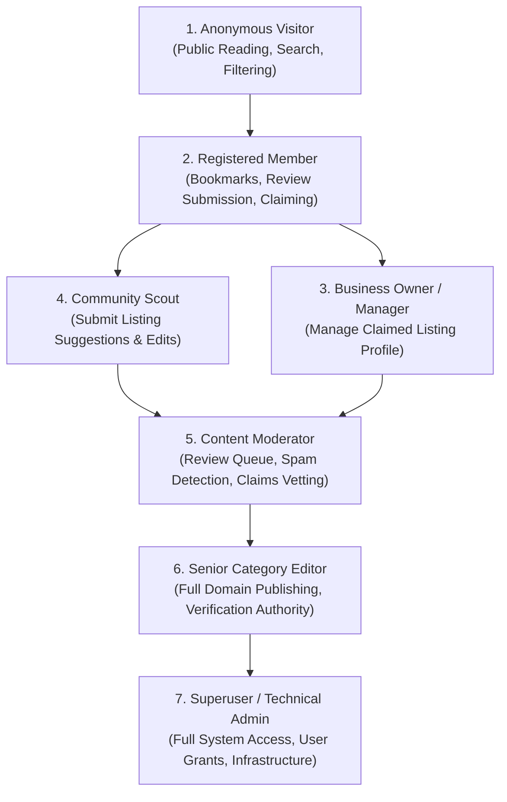
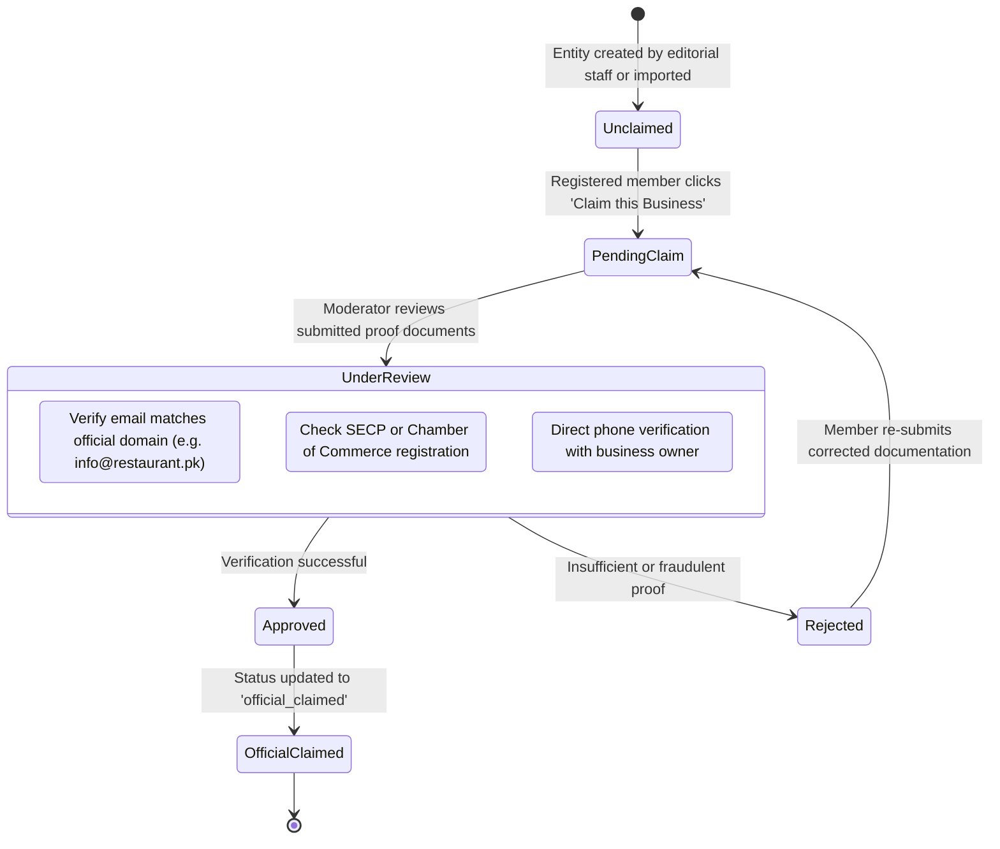

# User Roles, Permissions & Verification Governance
> **Project:** Lahore City Hub (LCH)  
> **Framework:** Django 5.2 Authentication & Authorization  
> **Document Version:** 1.0.0  
> **Status:** Final Architectural Specification

---

## 1. Role Taxonomy & Actor Hierarchy

To maintain the highest level of factual reliability while empowering community engagement, Lahore City Hub defines 7 distinct user personas:

---

## 2. Role-Permission Matrix

| Action / Capability | Anonymous Visitor | Registered Member | Business Owner | Community Scout | Content Moderator | Senior Editor | Superuser |
| :--- | :---: | :---: | :---: | :---: | :---: | :---: | :---: |
| **Browse public directories & search** | ✅ | ✅ | ✅ | ✅ | ✅ | ✅ | ✅ |
| **Save bookmarks / favorites** | ❌ | ✅ | ✅ | ✅ | ✅ | ✅ | ✅ |
| **Submit public reviews** | ❌ | ✅ (Pending) | ✅ (Pending) | ✅ (Pending) | ✅ (Direct) | ✅ (Direct) | ✅ (Direct) |
| **Submit business claim** | ❌ | ✅ | ✅ | ✅ | N/A | N/A | N/A |
| **Edit claimed business profile** | ❌ | ❌ | ✅ (Own Only) | ❌ | ❌ | ✅ | ✅ |
| **Suggest listing correction** | ❌ | ✅ | ✅ | ✅ | ✅ | ✅ | ✅ |
| **Access Django Admin portal** | ❌ | ❌ | ❌ | ❌ | ✅ (Staff) | ✅ (Staff) | ✅ (Superuser)|
| **Moderate & approve user reviews** | ❌ | ❌ | ❌ | ❌ | ✅ | ✅ | ✅ |
| **Review & decide business claims** | ❌ | ❌ | ❌ | ❌ | ✅ | ✅ | ✅ |
| **Mark listing as 'Verified'** | ❌ | ❌ | ❌ | ❌ | ❌ | ✅ | ✅ |
| **Publish Emergency City Updates** | ❌ | ❌ | ❌ | ❌ | ❌ | ✅ | ✅ |
| **Manage user roles & system settings**| ❌ | ❌ | ❌ | ❌ | ❌ | ❌ | ✅ |

---

## 3. Django Groups & Permission Implementation

The platform utilizes Django's native `django.contrib.auth.models.Group` and `Permission` infrastructure configured via data migrations.

### Group 1: `Registered Members`
- Default group assigned upon email verification.
- **Permissions:**
  - `accounts.add_userbookmark`, `accounts.delete_userbookmark`
  - `reviews.add_review`
  - `businesses.add_businessclaim`

### Group 2: `Business Owners`
- Assigned automatically once an official `BusinessClaim` transitions to `approved`.
- **Permissions:**
  - Inherits Member permissions.
  - Custom row-level permission: `change_business` restricted to their approved entity via `Business.claimed_by == request.user`.

### Group 3: `Community Scouts`
- Trusted members granted permission to submit proposed updates or new places without CAPTCHA friction.
- **Permissions:**
  - `places.add_place` (saved in `pending` moderation status).
  - `events.add_event` (saved in `pending` moderation status).

### Group 4: `Content Moderators`
- Staff members (`is_staff=True`) with access to the Django Admin moderation dashboard.
- **Permissions:**
  - `reviews.change_review`, `reviews.delete_review` (can approve or reject reviews).
  - `businesses.change_businessclaim` (can review proofs, approve/reject claims).
  - `accounts.view_customuser`, `accounts.view_userprofile`

### Group 5: `Senior Editors`
- Domain experts authorized to verify listings, publish emergency advisories, and edit historical content.
- **Permissions:**
  - All directory app CRUD permissions (`add`, `change`, `delete`, `view`).
  - Authority to toggle `verification_status` to `'verified'`.
  - `updates.add_cityupdate`, `updates.change_cityupdate`, `updates.delete_cityupdate`

---

## 4. The Business Claim Verification Workflow

To safeguard against unauthorized takeovers of prominent Lahore establishments:

### Verification Requirements:
1. **Corporate Email Check:** Claimants submitting with an official institutional domain (e.g., `@punjab.gov.pk`, `@doctorshospital.pk`, `@lahoreschool.edu.pk`) receive fast-track verification.
2. **Document Upload:** Claimants with generic email addresses (e.g., `@gmail.com`) must upload a utility bill, business letterhead, or official registration certificate.
3. **Audit Log:** When a claim is approved, the system automatically populates `verified_by`, `last_verified_at`, and attaches the audit log entry.

---

## 5. Review Moderation & Quality Governance

To prevent slander, competitive sabotage, or synthetic positive reviews:
1. **Pre-Moderation by Default:** Reviews submitted by new accounts (`member` role) enter `pending` state until reviewed by a Moderator.
2. **Profanity & Spam Gate:** Automated regex and keyword filters check for abusive language, hate speech, external phishing URLs, or spam patterns before touching the moderation queue.
3. **One Review Per Entity Rule:** A user can submit only one review per listing. Subsequent submissions update their existing review rather than artificially inflating review counts.

---

## 6. Audit Logging & Accountability

1. **Staff Action Records:** Django Admin history logs every change made to listings, tracking the responsible staff user, IP address, and changed fields.
2. **Verification Immutability:** Any update to a `Verified` listing triggers an alert to Senior Editors if critical fields (phone number, address, banking/payment details) are modified.
